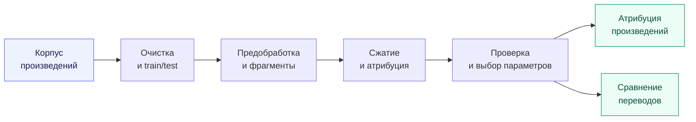
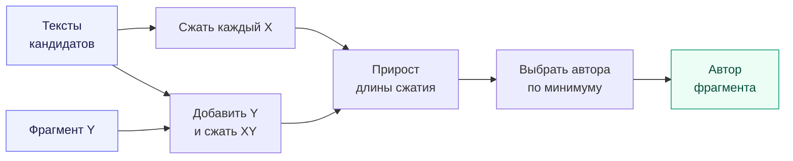
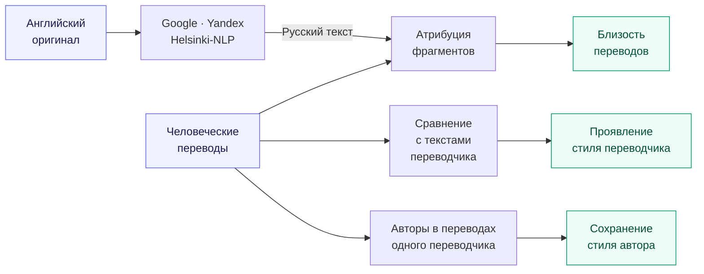

# Определение авторства текста с помощью сжатия

Исследовательский проект по теории информации в Университете Иннополис. Определяли автора литературного текста по тому, насколько хорошо его фрагменты сжимаются после известных произведений разных писателей. Воспроизвели эксперименты Рябко и Савиной, сравнили методы сжатия и применили подход к выбору перевода, сохраняющего стиль автора.

Получили **93,0% accuracy на корпусе из 17 авторов** и **88,64% на корпусе авторов XIX века**. Атрибуция подтвердила авторство Ильфа и Петрова для «Двенадцати стульев» и «Золотого телёнка». Среди трёх переводов «Тома Сойера» лучше всего стиль Твена сохранил перевод Чуковского.

[Ноутбук с экспериментами](experiments.ipynb) · [Подробные результаты](docs/RESULTS.md) · [Презентация](docs/presentation.pdf)

**Стек:** Python, NumPy, pandas, SciPy, NLTK, matplotlib, seaborn, PyTorch, Transformers.

## Общий пайплайн



Сначала проверили, насколько метод различает известных авторов и как результат зависит от компрессора, предобработки и объёма текста. Затем использовали выбранные параметры в литературных задачах: определении авторства и сравнении переводов.

## Данные и проверка

Собрали два корпуса русской прозы: **17 авторов 1915–1940 годов** и **11 авторов XIX века**. В [модуле подготовки данных](src/data_pipeline.py) реализовали очистку служебных символов, заголовков и ссылок, разделение произведений на train/test и сборку текстов заданного объёма. Разделение выполняли по произведениям; выбранные книги, seed и настройки сохраняли в метаданные.

Для каждого автора подготовили восемь вариантов текста: исходный или нижний регистр, с пунктуацией или без неё, со стоп-словами или без них. Тестовый текст разбивали на фрагменты и определяли автора каждого из них. Результат собирали в матрицу атрибуции, по которой считали accuracy, χ² и p-value.

Перед атрибуцией исследуемых романов проверяли различимость кандидатов на их известных произведениях. «Собачье сердце» использовали как отдельную проверку и исключили из обучающих текстов Булгакова.

## Определение автора

Берём известный текст автора X и проверяемый фрагмент Y. Считаем, сколько байтов добавляется к сжатому представлению после объединения текстов:

$$
\Delta_C(Y \mid X) = C(XY) - C(X).
$$

Здесь C — длина результата сжатия в байтах. Автором фрагмента выбираем кандидата с минимальным приростом:

$$
\widehat{a}(Y) = \arg\min_{a} \Delta_C(Y \mid X_a).
$$

Компрессор использует закономерности первого текста при кодировании второго. Похожий стиль помогает сжать дополнительный фрагмент лучше. Для классических компрессоров отдельный обучаемый классификатор не требуется.



Длину сжатия известных текстов кэшировали внутри эксперимента: для каждого нового фрагмента повторно считали только сжатие объединённого текста. Реализация метода и метрик — в [src/theory.py](src/theory.py).

## Выбор компрессора и параметров

Сравнили gzip, bzip2, LZMA, Zstandard и Brotli, методы смешивания контекстов PAQ и CMIX, нейросетевой компрессор NNCP и оценки длины сжатия на основе GPT-2/ruGPT. Для вероятностных моделей использовали LLM-based compression и TS-zip.

В серии сравнения компрессоров на первом корпусе получили следующие результаты:

| Метод | Accuracy |
| --- | --- |
| **PAQ** | **71,3%** |
| LZMA | 64,3% |
| NNCP | 63,2% |
| Zstandard | 56,6% |
| Brotli | 53,7% |
| LLM-based compression | 38,6% |

**PAQ оказался лучшим на первом корпусе, LZMA — на корпусе XIX века.** В этом сравнении нейросетевые подходы не дали преимущества по качеству атрибуции. Лучшей предобработкой для обоих корпусов оказалось сохранение регистра, пунктуации и стоп-слов.

Объём обучающих и тестовых текстов исследовали в отдельной серии экспериментов:

| Объём текста, КБ | 17 авторов 1915–1940 годов | Авторы XIX века |
| --- | --- | --- |
| 32 | 51,1% | 47,73% |
| 64 | 68,4% | 61,93% |
| 128 | 86,4% | 80,68% |
| **256** | **93,0%** | **88,64%** |

Лучший исследованный объём — **256 КБ**. Рост контекста заметно улучшил различение авторов. Полные таблицы и связь экспериментов со статьями — в [описании результатов](docs/RESULTS.md).

## Атрибуция литературных текстов

Булгакова и Ильфа/Петрова рассматривали как двух кандидатов. На их известных произведениях при текстах по 256 КБ получили **64 правильных определения из 64 для каждого кандидата**. Затем проверили отдельные произведения:

| Произведение | Фрагменты, отнесённые к Булгакову | Фрагменты, отнесённые к Ильфу и Петрову |
| --- | --- | --- |
| «Собачье сердце» | **64** | 0 |
| «Двенадцать стульев» | 6 | **58** |
| «Золотой телёнок» | 7 | **57** |

Результаты подтвердили авторство Ильфа и Петрова для обоих романов.

Для совместных произведений Некрасова и Панаевой определяли авторство отдельных частей. В «Трёх странах света» наибольший вклад определён у Панаевой. В «Мёртвом озере» часть 11 отнесена к Панаеву, части 5, 10, 12 и эпилог — к Некрасову, остальные — к Панаевой.

## Выбор перевода

Сравнили переводы «Приключений Тома Сойера» Чуковского, Энгельгардта и Дарузес. Проверяли две вещи: насколько переводчик привносит собственный стиль и насколько сохраняет стиль исходного автора.

Для первой задачи сопоставляли переводы с собственными произведениями переводчиков. Для второй проверяли различимость разных исходных авторов в переводах одного переводчика. Дополнительно перевели английский оригинал через Google, Yandex и Helsinki-NLP и сравнили полученные русские тексты с тремя человеческими переводами.



Сильнее всего собственный стиль проявился у Дарузес, слабее всего — у Энгельгардта. В проверке различимости исходных авторов лучше всего сохранил оригинальный стиль Чуковский, хуже всего — Энгельгардт.

При сравнении с машинными переводами использовали тексты по 128 КБ и 32 тестовых фрагмента. Число фрагментов, отнесённых к каждому человеческому переводу:

| Машинный перевод | Чуковский | Энгельгардт | Дарузес |
| --- | --- | --- | --- |
| Google | **18** | 13 | 1 |
| Yandex | **16** | 15 | 1 |
| Helsinki-NLP | **19** | 11 | 2 |

Все три метода дали наибольшую близость к переводу Чуковского. **Перевод Чуковского лучше всего сохранил стиль Твена среди рассмотренных вариантов.**

## Что осталось за рамками

- Прямое сравнение оригинала и перевода через межъязыковой компрессор осталось направлением для продолжения. Для преодоления языкового различия использовали анализ стиля переводчиков и машинный перевод.
- Для GPT-2/ruGPT реализовали оценку длины по вероятностям токенов; собственный кодер и декодер сжатого файла не разрабатывали. NNCP и CMIX подключили как внешние инструменты.
- Отдельное приложение и единый CLI для всех экспериментов не делали. Рабочий формат проекта — Python-модули и исследовательский ноутбук.

## Запуск

Клонирование проекта:

```bash
git clone git@github.com:revlze/compression-authorship.git
cd compression-authorship
```

Базовое окружение для классических компрессоров и ноутбука — Python 3.12 и [uv](https://docs.astral.sh/uv/):

```bash
uv venv --python 3.12
source .venv/bin/activate
uv pip install nltk numpy pandas scipy zstandard brotli matplotlib seaborn jupyterlab
python -m nltk.downloader stopwords
jupyter lab experiments.ipynb
```

Для экспериментов с PAQ и машинным переводом установите зависимости из исходного списка. Для сборки PAQ нужны Cython и инструменты сборки C/C++:

```bash
uv pip install Cython setuptools wheel
uv pip install paq --no-build-isolation
uv pip install -r requirements.txt
```

Для GPT-2/ruGPT и Helsinki-NLP дополнительно нужны `torch`, `transformers` и `sentencepiece`. Для NNCP и CMIX — внешние исполняемые файлы в PATH.

Ноутбук запускается из корня проекта. Перед первым экспериментом выполните генерацию данных в разделе «1.2 Генерация датасетов» — соответствующие вызовы закомментированы. Полученные тексты сохраняются в `data/processed/`, которая исключена из Git. Эксперименты запускаются по разделам.

Короткий пример для отдельной ячейки — два автора и LZMA:

```python
from src.data_pipeline import process
from src.preprocessing import split_into_slices
from src.theory import build_table, get_accuracy

authors = ["Bulgakov", "Ilf_and_Petrov"]
for author in authors:
    process(author, train_kb=64, test_kb=64, seed=42)
split_into_slices(authors, n_slices=16)

table = build_table(
    authors, "origcase_withpunct_withstop",
    n_slices=16, compressor="lzma", lvl=6,
)
print(table)
print(f"Accuracy: {get_accuracy(table):.2%}")
```

## Структура

| Файл / каталог | Назначение |
| --- | --- |
| [experiments.ipynb](experiments.ipynb) | Эксперименты, таблицы и визуализации |
| [src/](src/) | Подготовка данных, компрессоры, метрики и машинный перевод |
| [data/raw/](data/raw/) | Исходные произведения и переводы |
| [docs/](docs/) | Условие задания, презентация и описание результатов |
| [tests/](tests/) | Проверки вспомогательных функций и обёрток нейросетевых методов |

## Статьи и команда

- Ryabko, B.; Savina, N. [Using Data Compression to Build a Method for Statistically Verified Attribution of Literary Texts](https://www.mdpi.com/1099-4300/23/10/1302). *Entropy*, 2021, 23(10), 1302. Основа метода атрибуции и двух литературных задач.
- Ryabko, B.; Savina, N. [Information-Theoretic Method for Assessing the Quality of Translations](https://www.mdpi.com/1099-4300/24/12/1739). *Entropy*, 2022, 24(12), 1739. Основа экспериментов со стилем автора и переводчика.

**Команда:** Всеволод Перетятко, Платон Усачев, Кирилл Савицкий, Даниил Недугов.

[Условие задания](docs/assignment.png) · [Лицензия MIT](LICENSE)
